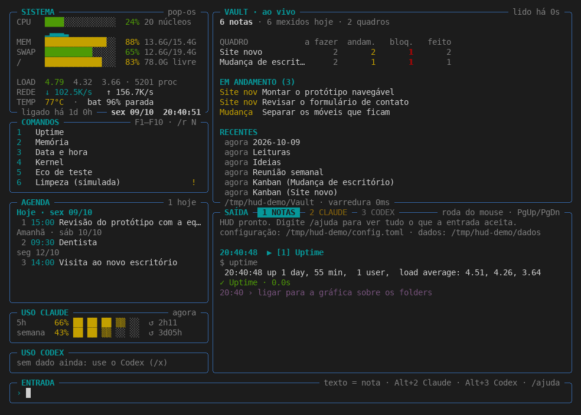
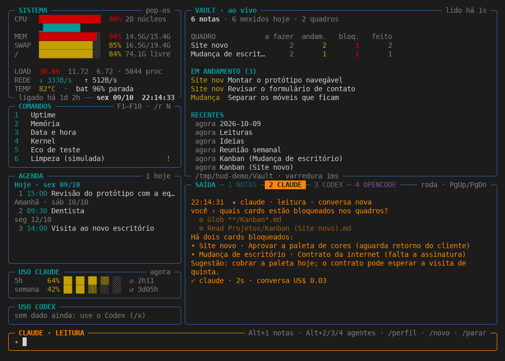
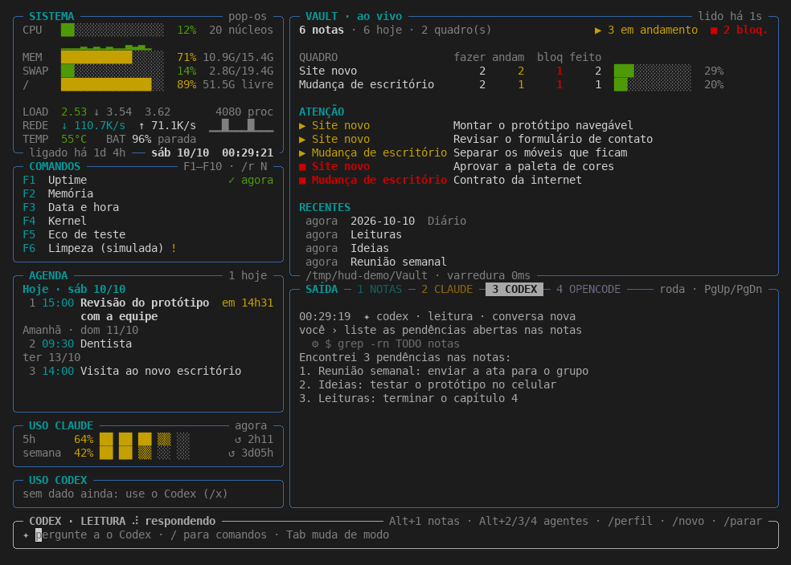
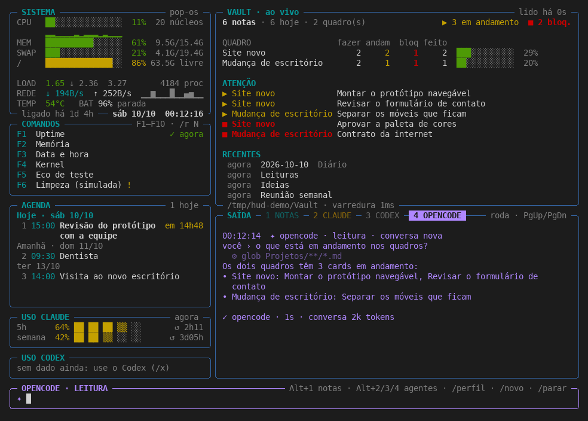
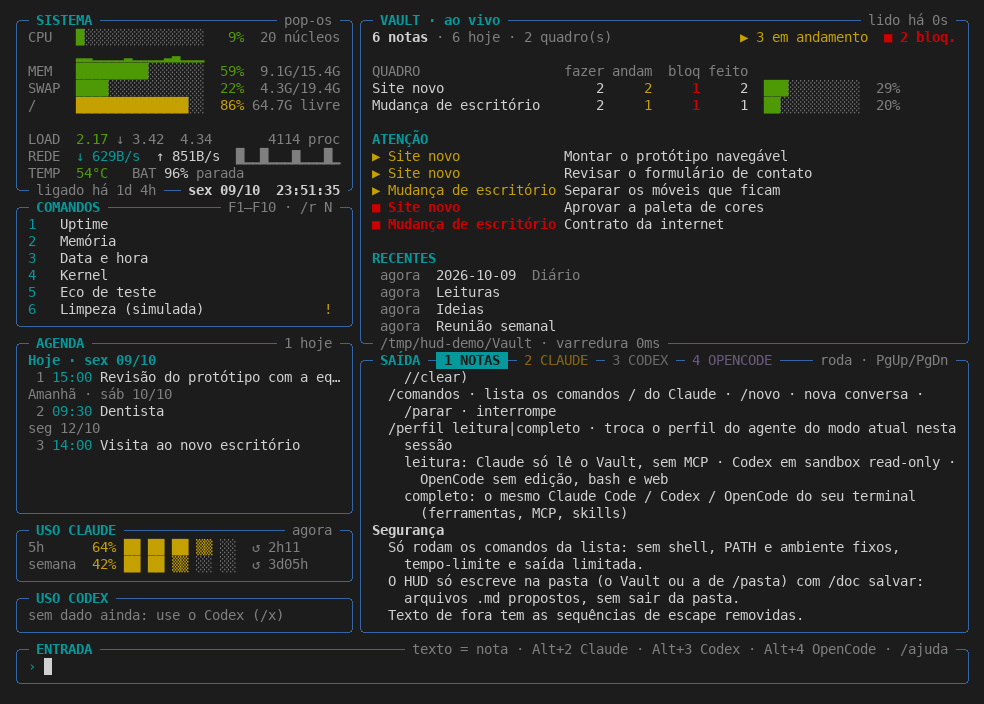
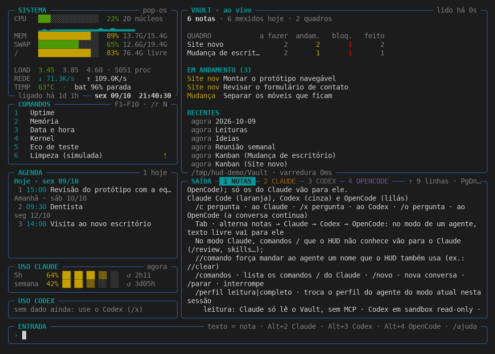
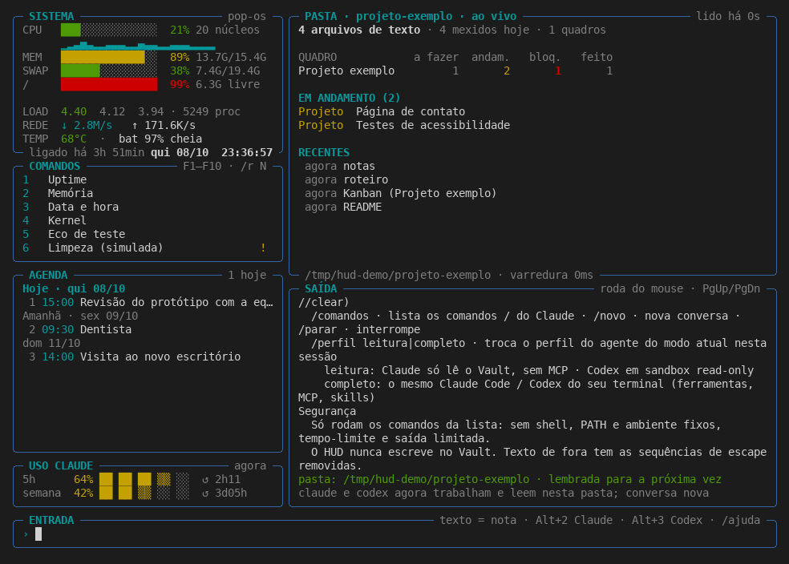
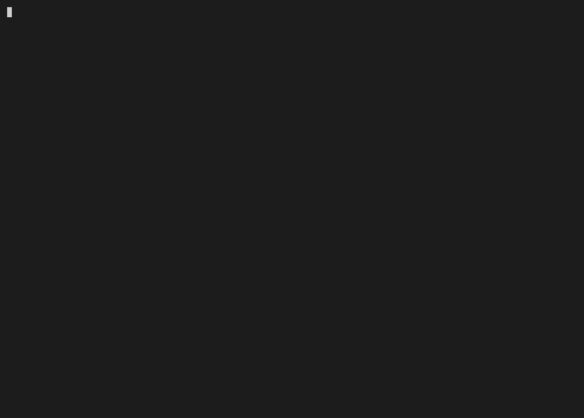

> Registro de capturas/fixtures da implementação legada. Não comprova a tela/runtime-alvo Rust atual; mídia original preservada. scripts/record-screens.py pertence ao legado e pode regenerar o README antigo: não usá-lo para substituir o guia-alvo atual.

## Telas gravadas

Execução real do HUD num pseudo-terminal (pty) de 120×40, com `TERM=xterm-256color` e teclas de verdade. Os PNGs e o GIF são quadros renderizados da gravação, não capturas de tela do desktop. Todos os dados são de demonstração: HOME, Vault, agenda, comandos e cache de uso sintéticos, e o Claude, o Codex e o OpenCode são scripts falsos que respondem no formato real. Só os números do painel SISTEMA (CPU, memória, disco) são da máquina que gravou.

**Revisão gravada:** `94aca32`, em 2026-10-10. Para gravar de novo: `python3 scripts/record-screens.py` (o HUD continua sem dependências; só a renderização usa Pillow, num ambiente virtual temporário).

Tela inicial no modo notas: sistema, comandos, agenda, uso do Claude, Vault ao vivo e a saída na aba NOTAS.

Aba e modo Claude (laranja): uma pergunta e a resposta do Claude falso.

Aba e modo Codex (cinza): a pergunta e a resposta chegando do Codex falso.

Aba e modo OpenCode (lilás): a pergunta e a resposta do OpenCode falso.

/ajuda na saída.

Saída rolada para cima com a roda do mouse.

/pasta com um projeto de exemplo no lugar do Vault.

Sessão inteira, animada: notas, Claude, Codex, OpenCode, ajuda, rolagem e /pasta.

A gravação crua fica em `docs/telas/hud-demo.cast` (asciinema v2), `hud-demo.pty.txt` e `hud-demo.metadata.json` (revisão, duração, teclas enviadas e sha256 do código).
